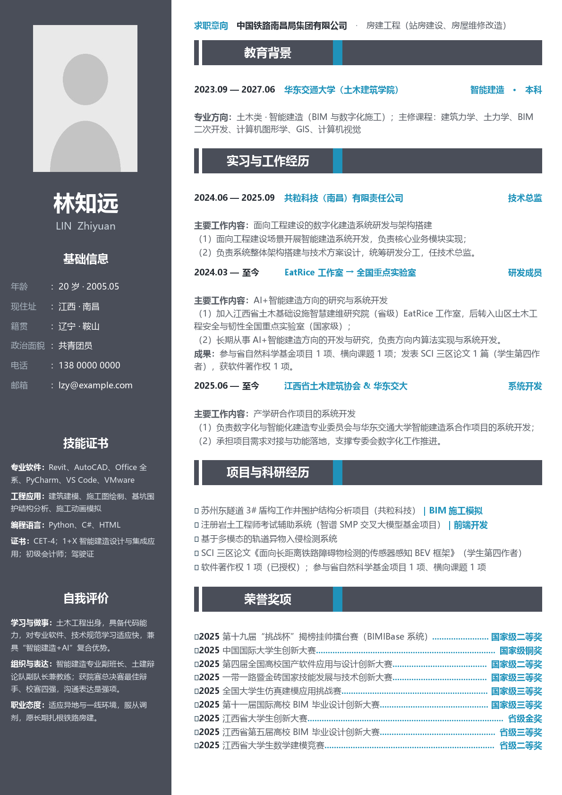
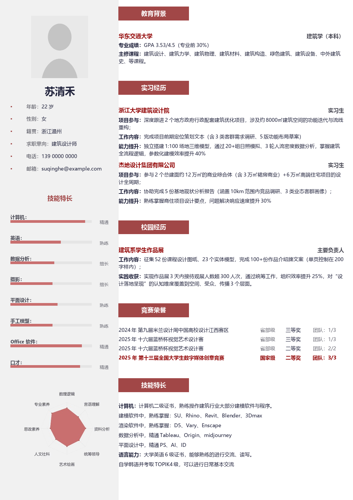
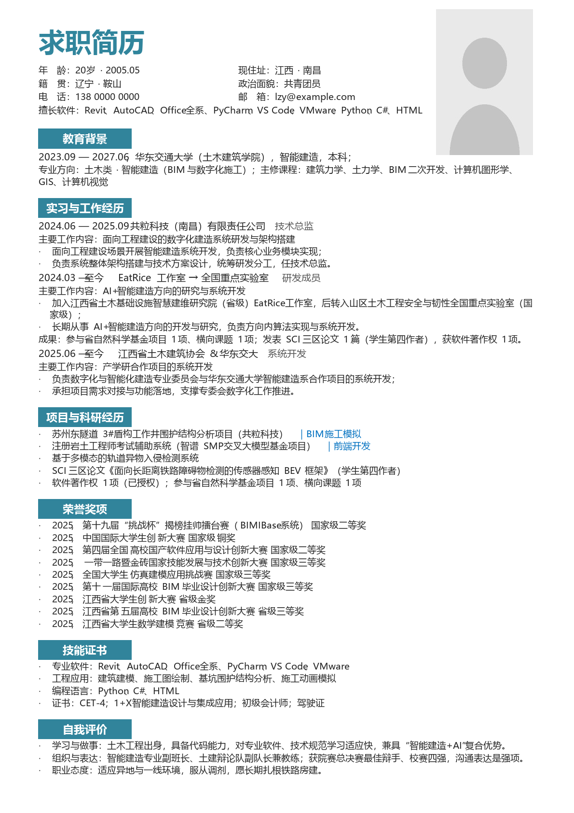

# dsh-resume-kit · 简历生成插件

给 DSH 加三个工具：**列版式**、**缺项体检**、**生成简历**。用户在对话里说清目标岗位和经历，
插件按模板排版渲染出**可编辑的 Word**，并同时导出 PDF；缺什么信息会反过来问用户。

不联网、不抓取任何平台内容——版式是仓库里的静态资产，内容是用户自己的经历。

| 深灰蓝（工科/国企） | 酒红绶带（建筑/设计） | 单栏 ATS（网申/机筛） |
|---|---|---|
|  |  |  |

## 怎么用

装好后在 DSH 里直接说人话即可：

> 帮我做一份投铁路局房建岗的简历，我叫林知远，华东交大智能建造 2027 届……

Agent 会自动：**先调 `resume_template_list` 把三套版式摆给你挑**（不选不会替你默认）→ 把零散信息整理成数据 → `resume_intake`
问清缺口 → `resume_generate` 出 docx + PDF。

也可以直接调工具：

```jsonc
resume_intake({ template: "wine-ribbon", data: { basics: { name: "苏清禾" } } })
// → { ready: false, missing: [{ key: "photo", question: "这一版是围绕照片排的……", required: true }, ...] }

resume_generate({
  data: { /* resume-spec v2，见 engine/spec.md */ },
  template: "dark-blue",
  outDir: "D:/你的工作区/resume"
})
// → { ok, docx: "...", pdf: "...", warnings: [...], missing: [...] }
```

## 版式库

| id | 名称 | 页数 | ATS 友好 | 适合 | 不适合 |
|---|---|---|---|---|---|
| `dark-blue` | 深灰蓝·双栏工科 | 1 | 否 | 国企/设计院/铁路局等严肃工程岗；2—3 段实习；荣誉多 | 网申机器筛选；经历单薄时右栏会空 |
| `wine-ribbon` | 酒红绶带·双栏设计 | 1 | 否 | 建筑/环境/室内设计；应届生用进度条+雷达图量化软实力 | 纯工程岗会显得花 |
| `single-ats` | 单栏·ATS 友好 | 1 | **是** | 国企/央企网申、大厂校招机筛、黑白打印、邮件正文粘贴 | 靠版式撑气质的岗位；想用色块分层的 |

三套版式都是从成品简历反推出来的：深灰蓝对标一份国企/设计院方向的单页双栏简历，
酒红绶带对标一份建筑学专业的设计感简历，单栏 ATS 对标一份蓝色大标 + 青色小节色块的 Word 简历。
**分栏宽度、标题条尺寸、行距、字号、对齐方式全部按原件还原**，用户只需要换内容，不用再调整版式。

- `dark-blue` 与原件逐行坐标核对：主栏文字行误差 ≤ 0.1pt（约 0.03mm），侧栏 ≤ 2pt。
- `wine-ribbon` 与原图逐块核对：小节标题条纵向位置误差 ≤ 0.7cm，栏宽/标题条宽度一致。
- `single-ats` 单栏、无分栏无文本框；小节标题在原文档里是文本框，这里改成同尺寸同配色的表格色块，外观一致但文字仍在正文流里，解析器读得到。正文按紧凑档排，**超过一页会自动微缩**（0.95 / 0.90 各重排一次），仍放不下才提示删内容。

## 数据规格

一句话：`basics`（姓名/英文名/照片/求职意向/基础信息/侧栏小节）+ `sections`
（`education`、`experience`、`bullets`、`awards`、`text` 五类，按数组顺序渲染）。

侧栏小节支持三种形态：`lines`（文字行）、`bars`（技能进度条）、`radar`（能力雷达图）。

**照片规则**：`dark-blue` 与 `wine-ribbon` **必须**有照片（缺照片或路径不对会直接拦下来让你去要）；`single-ats` **可选**——不少网申系统不看照片，不要照片时版头自动拉满整行。照片会按画框比例居中裁切。

**技能熟练度**：只给「精通/熟练/擅长/了解」时按 `精通 .92 / 擅长 .78 / 掌握 .74 / 良好 .72 / 熟练 .70 / 熟悉 .66 / 一般 .50 / 了解 .38 / 入门 .25` 折算长度；想精确控制就直接给 `percent`。

**能力雷达**：默认 8 维（数理逻辑/言语理解/资料分析/统筹领导/艺术绘画/人文社科/思政素养/专业素养），维度可增删、改名，轴数随意。

**一页优先**：`single-ats` 用紧凑字号（正文 9.5pt）排，生成后会数 PDF 页数——超过一页就按 95%、90% 自动重排一次，还放不下才在 `warnings` 里让你删内容。返回里带 `pages` 和 `layoutScale`。

正文支持两种行内标记：

| 写法 | 效果 | 用途 |
|---|---|---|
| `**文字**` | 加粗 | 段首小标题、动作动词 |
| `{{文字}}` | 加粗 + 强调色 | 量化成果（全篇 ≤ 6 处） |

完整字段与示例见 [engine/spec.md](engine/spec.md)，可运行样例见
[examples/spec-song.json](examples/spec-song.json)（深灰蓝）、
[examples/spec-hu.json](examples/spec-hu.json)（酒红绶带）。

## 「缺什么就问」是怎么实现的

`resume_intake` 把数据按版式体检一遍，返回三类东西：

1. **missing**：逐条给出 `key`、`question`（可以直接发给用户的原话）、`example`、`required`。
   - 通用必填：姓名、联系方式、教育背景、至少一段经历。
   - 版式专属：`dark-blue` 的照片、求职意向行、侧栏技能证书、荣誉；
     `wine-ribbon` 的照片、技能进度条、能力雷达、竞赛荣誉；
     `single-ats` 的求职意向行、关键词覆盖（照片是可选项，会明确问「放不放」）。
2. **warnings**：内容质量问题（占位符、经历超 4 条、条目只有单位没写做了什么）。
3. **ready**：必填项是否齐，齐了才建议生成。

不替用户编内容、不填默认值——用户说「没有」的项直接从数据里去掉，版面会自动收。

## 目录结构

```
dsh-resume/
├── lib/
│   ├── index.js          插件宿主：注册三个工具、探测 python 与 LibreOffice
│   └── intake.js         缺项体检规则（每版式一份）
├── engine/
│   ├── build_resume.py   渲染引擎入口（dispatch + 深灰蓝版式）
│   ├── layout_wine.py    酒红绶带版式
│   ├── layout_ats.py     单栏 ATS 版式
│   ├── radar.py          能力雷达图（Pillow 画 300dpi PNG）
│   └── spec.md           数据规格 v2
├── templates/index.json  版式元数据
├── examples/             可直接跑的样例数据（同一份数据可换三种版式渲染）
├── assets/
│   ├── source/           用户提供的原始模板 PDF
│   └── photos/           样例照片（占位头像，不含真人）
├── scripts/              安装 / 卸载（BOM 安全 + 写后校验）
├── tools/plugin-smoke.mjs 冒烟测试（不启 DSH，走桩 ctx）
└── docs/                 预览图
```

## 安装

```bash
dsh plugin add dsh-resume-kit     # 从 npm 装（推荐；桌面端只认已发布到 npm 的包）
```

本仓库里另带两个 PowerShell 脚本，用于把源码目录直接挂到当前 profile（开发时用）：

```powershell
powershell -NoProfile -ExecutionPolicy Bypass -File .\scripts\install-plugin.ps1
powershell -NoProfile -ExecutionPolicy Bypass -File .\scripts\uninstall-plugin.ps1
```

脚本顺序是「建联接 → 验证解析 → 再改配置」，写好 `package.json` 后还会用 `JSON.parse` 复验——
带 BOM 的清单会让 DSH 进安全模式，这里已经踩过坑并加了校验。装完重启 DSH 生效。

## 环境要求

- 渲染用 **python-docx**，优先使用 DSH 桌面端自带的 python
  （`<安装目录>/resources/office-runtime/.../python.exe`），找不到才退回 PATH 上的 `python`。
- 雷达图用 **Pillow**（同一份 python 自带；缺了就不画雷达，其余照常出）。
- PDF 用 DSH 自带的 LibreOffice Kit（`<安装目录>/resources/office-cli.mjs`）；
  找不到时只出 docx，并在 `warnings` 里说明。
- 两点都可用插件配置覆盖：`python`、`officeNode`、`officeCli`。

## 已知限制（都是有意取舍）

1. **绶带/横幅的斜切边做成了直角**。原模板小节标题左侧是斜切绶带（带折角和下垂的小尾巴），
   Word 原生元素做不出斜切；用图片能还原，但标题文字就不能编辑了。这里选可编辑。
   深灰蓝版式的「细条 + 留白 + 色块 + 强调块」是原生表格拼的，与原图一致。
2. **侧栏小图标换成方块/文字**。原图的日历、定位、信封是矢量图标，字体里没有对应字形，
   强行放 emoji 在不同电脑上会变彩色或豆腐块。默认不放，需要时用 `fields[].icon` 给个字符。
   `single-ats` 版式里的照片是浮动图片（不参与文字流），换行、加字都不会把照片挤走。
3. **双栏不适合 ATS**。很多大厂筛选系统会把双栏读串行；投这类岗位建议单栏版式。
4. **一页约束靠人**。引擎不会自动删减内容，经历超 4 条会告警，需要人来决定删什么。
5. **照片会按画框裁切**。原图是固定比例的相框，非该比例的照片会被居中裁掉一部分边缘。

## 下一步

- 加 1 套**单栏 ATS 友好**版式（给国企网申 / 大厂机器筛选）
- `resume_review`：拿 JD 和现有简历做匹配度打分，指出缺口
- 一岗一版：同一份经历按不同 JD 生成多个版本
